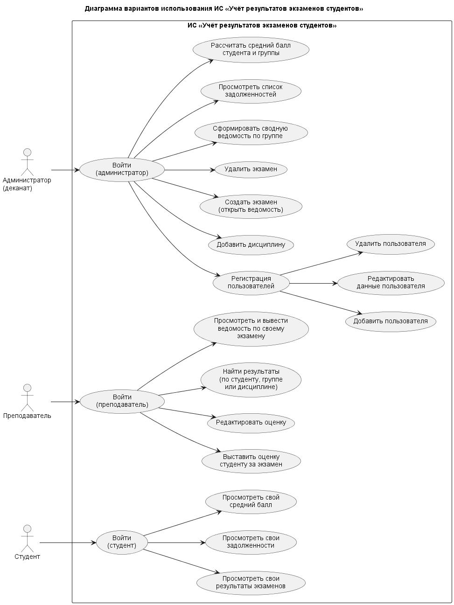
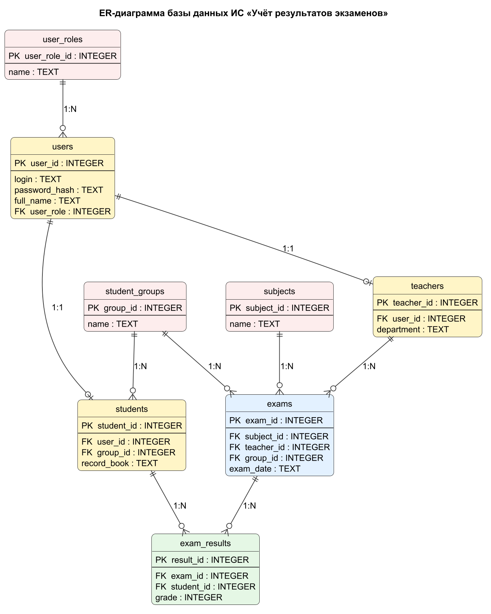

# ИС «Учёт результатов экзаменов студентов»

Консольная информационная система для учёта итогов промежуточной аттестации студентов. Учебный проект по дисциплине «Информатика» (НГТУ им. Р.Е. Алексеева).

> **Статус проекта:** реализована рабочая версия системы: модели данных, слой доступа к данным (репозитории), бизнес-логика, консольный интерфейс, вход в систему и разграничение прав по ролям (лабораторная работа №4).

## О проекте

Система хранит сведения о студентах, группах, дисциплинах, экзаменах и оценках в единой базе данных и заменяет бумажные ведомости. Деканат создаёт экзамены и следит за успеваемостью, преподаватели выставляют оценки, студенты в любой момент видят свои результаты и задолженности.

Работа над проектом ведётся по этапам:

1. постановка технического задания и моделирование процессов (лабораторная работа №1);
2. настройка рабочей среды, Git, оформление репозитория и диаграммы PlantUML (лабораторная работа №2);
3. проектирование и создание базы данных: ER-диаграмма, SQLite, `schema.sql` (лабораторная работа №3);
4. реализация слоя доступа к данным, бизнес-логики и консольного интерфейса на языке C (лабораторная работа №4).

## Предметная область

Основные информационные объекты:

| Объект | Содержание |
|--------|------------|
| Студент | ФИО, номер зачётной книжки, группа |
| Группа | название |
| Дисциплина | название |
| Экзамен | связывает дисциплину, группу, преподавателя и дату проведения |
| Результат экзамена | связывает студента и экзамен, содержит оценку |

Связи между объектами:

- в одной группе обучается несколько студентов;
- один студент сдаёт несколько экзаменов;
- один преподаватель может проводить экзамены по нескольким дисциплинам.

Оценка выставляется по заранее заданной шкале: **«2», «3», «4», «5»** или **«не явился»**. В базе данных неявка хранится как пустое значение (`NULL`) в поле `grade`.

## Цели системы

1. Хранить и систематизировать сведения о студентах, дисциплинах, экзаменах и оценках в единой базе данных.
2. Быстро находить результаты экзаменов по студенту, группе, дисциплине или дате.
3. Автоматизировать выставление и редактирование оценок вместо бумажных ведомостей.
4. Формировать ведомости по группе и дисциплине.
5. Рассчитывать средний балл студента и группы, составлять список задолженностей.
6. Разграничивать доступ к данным и функциям по ролям пользователей с помощью регистрации и аутентификации.

## Пользователи и роли

| Роль | Что может делать |
|------|------------------|
| Администратор (деканат) | управляет пользователями, дисциплинами и экзаменами, формирует сводные ведомости по группам, просматривает задолженности, считает средний балл |
| Преподаватель | выставляет и редактирует оценки по своим экзаменам, ищет результаты, выводит ведомость по своему экзамену |
| Студент | смотрит свои результаты, задолженности и средний балл |

Учётная запись администратора создаётся заранее при установке системы, самостоятельная регистрация с этой ролью не допускается. **Преподавателей и студентов регистрирует администратор**: при регистрации указываются логин, пароль и роль. Логин пользователя должен быть уникальным.

## Функции системы

**Администратор**

- вход в систему;
- регистрация пользователей: добавление, редактирование данных и удаление пользователя;
- добавление дисциплины;
- создание экзамена (открытие ведомости) и удаление экзамена;
- формирование сводной ведомости по группе;
- просмотр списка задолженностей;
- расчёт среднего балла студента и группы.

**Преподаватель**

- вход в систему;
- выставление оценки студенту за экзамен и редактирование оценки;
- поиск результатов по студенту, группе или дисциплине (только по своим экзаменам);
- просмотр и вывод ведомости по своему экзамену.

**Студент**

- вход в систему;
- просмотр своих результатов экзаменов;
- просмотр своих задолженностей;
- просмотр своего среднего балла.

## Диаграмма вариантов использования

Диаграмма построена на языке [PlantUML](https://plantuml.com/) по исправленной диаграмме use case из лабораторной работы №1. У каждой роли свой вариант использования «Войти», общих функций у преподавателя и студента нет.



## Архитектура

Выбрана классическая трёхуровневая архитектура:

| Уровень | Назначение |
|---------|------------|
| Представление | консольный интерфейс (CLI): ввод команд и вывод результатов |
| Бизнес-логика | проверка прав доступа по роли, контроль корректности оценки, запрет повторной оценки за один экзамен, расчёт статистики |
| Данные | репозитории (все SQL-запросы) и база данных SQLite |

В коде каждый уровень вынесен в отдельную папку, а вызовы идут строго сверху вниз:

```text
ui/  (меню, ввод и вывод)
 └─► services/  (проверки, права, расчёты)
      └─► repositories/  (SQL-запросы, CRUD)
           └─► db.c ─► SQLite (exams.db)
models/ — структуры данных, которыми обмениваются все уровни
```

Интерфейс не обращается к базе напрямую, а сервисы не содержат SQL. Поэтому консольный интерфейс можно заменить, например, на графический, не трогая бизнес-логику.

Технологии и инструменты:

| Инструмент | Назначение |
|------------|------------|
| Язык C | язык программирования |
| [SQLite](https://www.sqlite.org/) | база данных |
| [Git](https://git-scm.com/) и [GitHub](https://github.com/) | контроль версий и удалённый репозиторий |
| [Visual Studio Code](https://code.visualstudio.com/) | среда разработки |
| [PlantUML](https://plantuml.com/) | диаграммы по текстовому описанию |
| Markdown | оформление документации |

## База данных

Данные ИС «Учёт результатов экзаменов» хранятся в СУБД SQLite (один файл `exams.db`, отдельный сервер не нужен). Структура базы описана в [`src/db/schema.sql`](src/db/schema.sql).

### ER-диаграмма



Исходник диаграммы для PlantUML: [`docs/diagrams/er-diagram.puml`](docs/diagrams/er-diagram.puml).

### Таблицы

| Таблица          | Назначение                                                        |
|------------------|-------------------------------------------------------------------|
| `user_roles`     | Роли: администратор, преподаватель, студент                       |
| `users`          | Учётные записи (логин, зашифрованный пароль, ФИО, роль)           |
| `teachers`       | Профиль преподавателя (кафедра)                                   |
| `students`       | Профиль студента (группа, номер зачётной книжки)                  |
| `student_groups` | Учебные группы                                                    |
| `subjects`       | Дисциплины                                                        |
| `exams`          | Экзамен — открытая ведомость                                      |
| `exam_results`   | Строка ведомости: оценка студента на конкретном экзамене          |

### Связи

- **1:N** — `user_roles` → `users`; `student_groups` → `students`; `student_groups`, `subjects`, `teachers` → `exams`; `exams` → `exam_results`; `students` → `exam_results`.
- **1:1** — `users` → `teachers` и `users` → `students` (у одной учётной записи не больше одного профиля; обеспечивается ограничением `UNIQUE` на `user_id`).
- **M:N** — `students` ↔ `exams`: студент сдаёт много экзаменов, на экзамене присутствует много студентов. Реализована через таблицу-связку `exam_results`.

Просмотреть базу можно через `sqlite3 exams.db` (команды `.tables`, `.schema users`, `SELECT * FROM exam_results;`) или в DB Browser for SQLite.

## Реализация

### Модели данных (`models/`)

Каждой таблице соответствует структура `struct` — аналог `dataclass` в Python. Поля структуры повторяют столбцы таблицы, а **служебные поля** хранят то, чего в таблице нет, но что удобно показывать пользователю: название роли, ФИО, название группы и дисциплины. Они заполняются через `JOIN` и в базу обратно не записываются.

```c
typedef struct {
    int result_id;
    int exam_id;
    int student_id;
    int grade;            /* 2..5, GRADE_ABSENT — «не явился» (NULL в БД) */

    /* служебные поля, собранные из нескольких таблиц через JOIN */
    char student_name[FULL_NAME_LEN];
    char subject_name[SUBJECT_LEN];
    /* ... */
} ExamResult;
```

| Модель | Таблица | Служебные поля |
|--------|---------|----------------|
| `UserRole` | `user_roles` | — |
| `User` | `users` | `role_name` |
| `Teacher` | `teachers` | `full_name` |
| `Student` | `students` | `full_name`, `group_name` |
| `StudentGroup` | `student_groups` | — |
| `Subject` | `subjects` | — |
| `Exam` | `exams` | `subject_name`, `teacher_name`, `group_name` |
| `ExamResult` | `exam_results` | ФИО и зачётка студента, группа, дисциплина, дата, преподаватель |

### Репозитории (`repositories/`)

Репозиторий отвечает за одну сущность и содержит все SQL-запросы к ней. Значения передаются только через параметры `?` (`sqlite3_bind_*`), строки запросов не склеиваются — это защищает от SQL-инъекций. Строка результата превращается в модель функцией `map_row` (аналог `_map` из методички).

| Репозиторий | Create | Read | Update | Delete |
|-------------|--------|------|--------|--------|
| `user_role_repository` | — (справочник) | по id, все | — | — |
| `group_repository` | ✓ | по id, по названию, все | ✓ | ✓ |
| `subject_repository` | ✓ | по id, по названию, все | ✓ | ✓ |
| `user_repository` | ✓ | по id, по логину, все | логин и ФИО, пароль | ✓ |
| `teacher_repository` | ✓ | по id, по пользователю, все | кафедра | ✓ |
| `student_repository` | ✓ | по id, по пользователю, по зачётке, по группе, все | группа и зачётка | ✓ |
| `exam_repository` | ✓ | по id, по преподавателю, по группе, все | преподаватель и дата | ✓ |
| `exam_result_repository` | ✓ | по студенту, по группе, поиск, ведомость экзамена | оценка | ✓ |

Ведомость экзамена строится через `LEFT JOIN`, поэтому в неё попадают и студенты, которым оценка ещё не выставлена.

### Бизнес-логика (`services/`)

В C нет исключений, поэтому сервис при ошибке возвращает `SERVICE_ERROR` и записывает текст в буфер `err` — так же, как `raise Exception("...")` в методичке. Интерфейс просто выводит этот текст.

| Сервис | Что проверяет и считает |
|--------|-------------------------|
| `auth_service` | вход: введённый пароль шифруется шифром Виженера и сравнивается с `password_hash`; при ошибке одно сообщение «Неверный логин или пароль» |
| `user_service` | регистрация преподавателей и студентов (только администратором): уникальный логин без пробелов (3–30 символов), пароль из 6–32 латинских букв и цифр, непустое ФИО, существующая группа, уникальная зачётка; учётная запись и профиль сохраняются одной транзакцией; нельзя удалить администратора и преподавателя, у которого есть экзамены |
| `catalog_service` | дисциплины и группы без дубликатов (сравнение без учёта регистра, в том числе для русских букв) |
| `exam_service` | экзамен создаётся только для существующих дисциплины, группы и преподавателя; дата проверяется по календарю (`2027-02-30` не пройдёт); у группы не может быть двух экзаменов в один день |
| `result_service` | оценку ставит только преподаватель своего экзамена и только студенту группы, которая его сдаёт; допустимы 2–5 и «не явился»; повторно выставить оценку нельзя — только изменить; задолженность — это «2» или неявка; средний балл считается по оценкам 2–5 |

### Интерфейс и авторизация (`ui/`)

После входа каждая роль получает своё меню — это и есть разграничение доступа:

| Роль | Меню |
|------|------|
| Администратор | пользователи (список, регистрация преподавателя и студента, редактирование, удаление); дисциплины и группы; экзамены (создание, удаление, ведомость); сводная ведомость по группе; задолженности; средний балл студента и группы |
| Преподаватель | мои экзамены; выставление оценок; изменение оценки; ведомость по экзамену; поиск результатов по студенту, группе или дисциплине |
| Студент | мои результаты; мои задолженности; мой средний балл |

Функции входа и регистрации пользователей находятся в `ui/auth.c`. Самостоятельной регистрации нет: преподавателей и студентов регистрирует администратор.

Пример сводной ведомости:

```text
Сводная ведомость группы ИВТ-4-2

Студент                      Информатика    Линейная алге… Ср. балл
--------------------------------------------------------------------
Иванов Иван Иванович         5              4              4.50
Литвин Михаил Андреевич      2              3              2.50
Смирнова Мария Андреевна     4              н/я            4.00

Средний балл группы: 3.60 (оценок: 5)
н/я — не явился, — — оценка не выставлена
```

### Тестовые учётные записи

| Роль | Логин | Пароль |
|------|-------|--------|
| Администратор | `admin` | `admin123` |
| Преподаватель | `petrov`, `uchiha` | `teacher123` |
| Студент | `ivanov`, `smirnova`, `litvin`, `lebedeva`, `orlov` | `student123` |

## Структура проекта

```text
exam-results/
├── docs/
│   └── diagrams/              # use case и ER-диаграмма (.puml и .png)
├── src/
│   ├── db/
│   │   └── schema.sql         # структура БД и тестовые данные
│   └── exam-results/
│       ├── main.c             # точка входа: подготовка БД и главное меню
│       ├── db.c, db.h         # подключение к SQLite, общие функции запросов
│       ├── models/            # структуры данных (по одной на таблицу)
│       ├── repositories/      # слой доступа к данным: SQL и CRUD
│       ├── services/          # бизнес-логика
│       ├── ui/                # консольный интерфейс, вход и регистрация
│       ├── common/            # шифр паролей, работа со строками UTF-8
│       ├── sqlite3.c
│       └── sqlite3.h
├── .gitignore
└── README.md
```

## Требования

- [Git](https://git-scm.com/);
- компилятор языка C: [Visual Studio](https://visualstudio.microsoft.com/) с компонентом «Разработка классических приложений на C++» (MSVC) или [GCC](https://gcc.gnu.org/) (на Windows его проще получить через [MSYS2](https://www.msys2.org/)).

Библиотека SQLite подключена к проекту в виде исходных файлов `sqlite3.c` и `sqlite3.h`, отдельно устанавливать её не нужно.

## Установка и запуск

1. Клонировать репозиторий:

   ```bash
   git clone https://github.com/LaZzy-bip/exam-results.git
   ```

2. Перейти в папку проекта:

   ```bash
   cd exam-results
   ```

3. Скомпилировать программу.

   > **Сборка может занять около минуты.** Вместе с кодом проекта компилируется библиотека SQLite (`sqlite3.c`, около 9 МБ). Это нормально: компилятор не завис, нужно дождаться окончания.

   **Visual Studio (MSVC)** — в Developer Command Prompt for VS:

   ```bat
   cl /utf-8 /Fe:exam-results.exe src\exam-results\*.c src\exam-results\common\*.c src\exam-results\repositories\*.c src\exam-results\services\*.c src\exam-results\ui\*.c
   ```

   Ключ `/utf-8` обязателен, иначе русские строки в программе отобразятся неправильно.

   Если команда `cl` не найдена, терминал открыт без окружения Visual Studio. Нужно открыть Developer Command Prompt for VS из меню «Пуск» или в обычном cmd сначала выполнить `vcvars64.bat` из папки `VC\Auxiliary\Build` в каталоге Visual Studio.

   **GCC** — в терминале MSYS2 MinGW64:

   ```bash
   gcc -std=c11 -o exam-results.exe src/exam-results/*.c src/exam-results/common/*.c src/exam-results/repositories/*.c src/exam-results/services/*.c src/exam-results/ui/*.c
   ```

4. Запустить программу из корня репозитория (путь к `src/db/schema.sql` указан относительно него):

   | Терминал | Команда |
   |----------|---------|
   | cmd | `exam-results.exe` |
   | PowerShell | `.\exam-results.exe` |
   | Git Bash | `./exam-results` |

   Программа сама переключает консоль на UTF-8, поэтому русский текст отображается без `chcp 65001`.

При первом запуске программа создаёт файл `exams.db` и заполняет его тестовыми данными из `schema.sql`. Дальше данные сохраняются между запусками. Чтобы вернуть базу к исходным тестовым данным, программу запускают с ключом `--reset`:

```bat
exam-results.exe --reset
```

Пример работы:

```text
===== ИС «Учёт результатов экзаменов» =====
1. Войти
0. Выход из программы
Выберите действие: 1

===== Вход в систему =====
Логин: ivanov
Пароль: student123
Здравствуйте, Иванов Иван Иванович!

===== Студент: Иванов Иван Иванович (ИВТ-4-2) =====
1. Мои результаты экзаменов
2. Мои задолженности
3. Мой средний балл
0. Выйти из учётной записи
Выберите действие: 1

Дисциплина           Дата       Преподаватель            Оценка
-------------------------------------------------------------------------
Информатика          2027-01-21 Петров Пётр Петрович     5 (отлично)
Линейная алгебра     2027-01-24 Учиха Саске              4 (хорошо)
```

## Автор

Синтюков Дмитрий, группа 26-ИВТ-4-2, Нижегородский государственный технический университет им. Р.Е. Алексеева, 2026.
