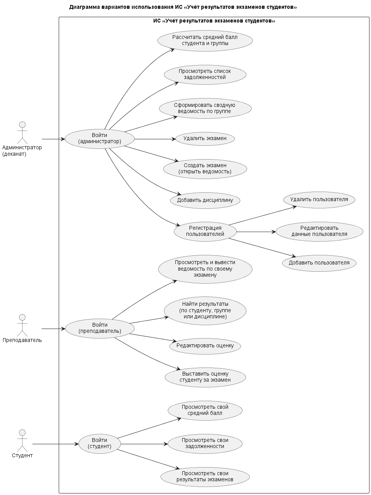

# ИС «Учёт результатов экзаменов студентов»

Консольная информационная система для учёта итогов промежуточной аттестации студентов. Учебный проект по дисциплине «Информатика» (НГТУ им. Р.Е. Алексеева).

> **Статус проекта:** система спроектирована (техническое задание и модель процессов из лабораторной работы №1), типовая структура проекта соблюдена. Сейчас в `src/main.c` лежит тестовая программа «Hello, World!»

## О проекте

Система хранит сведения о студентах, группах, дисциплинах, экзаменах и оценках в единой базе данных и заменяет бумажные ведомости. Деканат создаёт экзамены и следит за успеваемостью, преподаватели выставляют оценки, студенты в любой момент видят свои результаты и задолженности.

Работа над проектом ведётся по этапам:

1. постановка технического задания и моделирование процессов (лабораторная работа №1);
2. настройка рабочей среды, Git, оформление репозитория и диаграммы PlantUML (текущий этап);
3. реализация системы на языке C

## Предметная область

Основные информационные объекты:

| Объект | Содержание |
|--------|------------|
| Студент | ФИО, номер зачётной книжки, группа, курс |
| Группа | название, направление подготовки, год набора |
| Дисциплина | название, семестр, количество часов |
| Экзамен | связывает дисциплину, группу, преподавателя и дату проведения |
| Результат экзамена | связывает студента и экзамен, содержит оценку и дату её выставления |

Связи между объектами:

- в одной группе обучается несколько студентов;
- один студент сдаёт несколько экзаменов;
- один преподаватель может проводить экзамены по нескольким дисциплинам.

Оценка выставляется по заранее заданной шкале: **«2», «3», «4», «5»** или **«не явился»**.

## Цели системы

1. Хранить и систематизировать сведения о студентах, дисциплинах, экзаменах и оценках в единой базе данных.
2. Быстро находить результаты экзаменов по студенту, группе, дисциплине или дате.
3. Автоматизировать выставление и редактирование оценок вместо бумажных ведомостей.
4. Формировать ведомости по группе и дисциплине.
5. Рассчитывать средний балл студента и группы, составлять список задолженностей.
6. Разграничивать доступ к данным и функциям по ролям пользователей с помощью регистрации и аутентификации.

## Пользователи и роли

| Роль | Что может делать |
|------|------------------|
| Администратор (деканат) | управляет пользователями, дисциплинами и экзаменами, формирует сводные ведомости по группам, просматривает задолженности, считает средний балл |
| Преподаватель | выставляет и редактирует оценки по своим экзаменам, ищет результаты, выводит ведомость по своему экзамену |
| Студент | смотрит свои результаты, задолженности и средний балл |

Учётная запись администратора создаётся заранее при установке системы, самостоятельная регистрация с этой ролью не допускается. **Преподавателей и студентов регистрирует администратор**: при регистрации указываются логин, пароль и роль. Логин пользователя должен быть уникальным.

## Функции системы

**Администратор**

- вход в систему;
- регистрация пользователей: добавление, редактирование данных и удаление пользователя;
- добавление дисциплины;
- создание экзамена (открытие ведомости) и удаление экзамена;
- формирование сводной ведомости по группе;
- просмотр списка задолженностей;
- расчёт среднего балла студента и группы.

**Преподаватель**

- вход в систему;
- выставление оценки студенту за экзамен и редактирование оценки;
- поиск результатов по студенту, группе или дисциплине (только по своим экзаменам);
- просмотр и вывод ведомости по своему экзамену.

**Студент**

- вход в систему;
- просмотр своих результатов экзаменов;
- просмотр своих задолженностей;
- просмотр своего среднего балла.

## Диаграмма вариантов использования

Диаграмма построена на языке [PlantUML](https://plantuml.com/) по исправленной диаграмме use case из лабораторной работы №1. У каждой роли свой вариант использования «Войти», общих функций у преподавателя и студента нет.



## Архитектура

Выбрана классическая трёхуровневая архитектура:

| Уровень | Назначение |
|---------|------------|
| Представление | консольный интерфейс (CLI): ввод команд и вывод результатов |
| Бизнес-логика | проверка прав доступа по роли, контроль корректности оценки, запрет повторной оценки за один экзамен, расчёт статистики |
| Данные | база данных SQLite |

Технологии и инструменты:

| Инструмент | Назначение |
|------------|------------|
| Язык C | язык программирования |
| [SQLite](https://www.sqlite.org/) | база данных |
| [Git](https://git-scm.com/) и [GitHub](https://github.com/) | контроль версий и удалённый репозиторий |
| [Visual Studio Code](https://code.visualstudio.com/) | среда разработки |
| [PlantUML](https://plantuml.com/) | диаграммы по текстовому описанию |
| Markdown | оформление документации |

## Структура проекта

```text
exam-results/
├── src/
│   └── main.c              # точка входа в программу
├── docs/
│   └── diagrams/
│       ├── use-case.puml   # диаграмма в формате PlantUML
│       └── use-case.png    # сгенерированное изображение
├── .gitignore
└── README.md
```

## Требования

- [Git](https://git-scm.com/);
- компилятор языка C, например [GCC](https://gcc.gnu.org/) (на Windows его проще получить через [MSYS2](https://www.msys2.org/)).

Сторонние библиотеки пока не нужны: `src/main.c` использует только стандартную библиотеку C.

## Установка и запуск

1. Клонировать репозиторий (вместо `<ваш-логин>` подставьте имя пользователя на GitHub):

   ```bash
   git clone https://github.com/<ваш-логин>/exam-results-is.git
   ```

2. Перейти в папку проекта:

   ```bash
   cd exam-results-is
   ```

3. Скомпилировать программу:

   ```bash
   gcc -Wall -Wextra -o hello src/main.c
   ```

4. Запустить её:

   ```bash
   ./hello
   ```

   На Windows запуск выполняется командой `hello.exe`.

Ожидаемый вывод:

```text
Hello, World!
```

## Автор

Синтюков Дмитрий, группа 26-ИВТ-4-2, Нижегородский государственный технический университет им. Р.Е. Алексеева, 2026.
